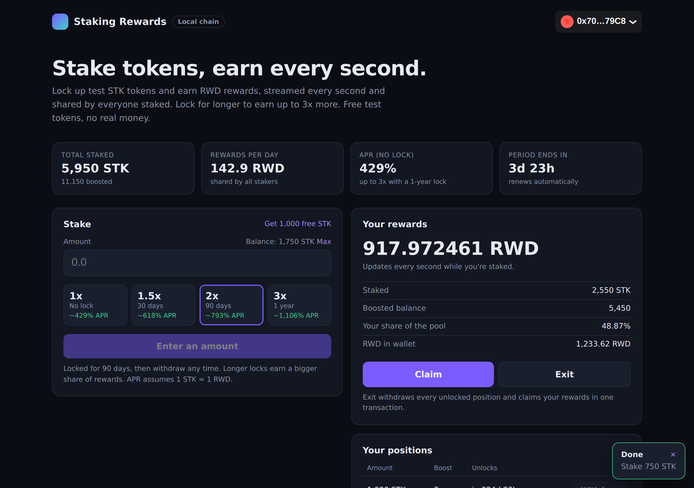
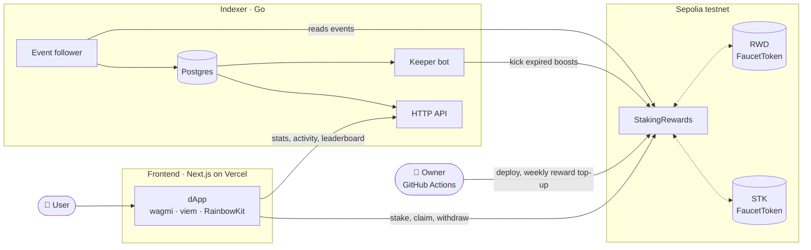

# Staking Rewards

[](https://github.com/rajdama/staking-rewards/actions/workflows/contracts.yml)
[](https://github.com/rajdama/staking-rewards/actions/workflows/frontend.yml)
[](https://github.com/rajdama/staking-rewards/actions/workflows/indexer.yml)


A full-stack staking protocol: **lock up tokens, earn rewards every second, and lock for longer to earn
up to 3x more.** Solidity contracts, a Next.js dApp, and a Go indexer with its own API and keeper bot.

> **Live demo:** coming soon on the Sepolia testnet ([how it gets deployed](#deploying-it-yourself)).
> Free test tokens, no real money.



*The dApp right after staking 750 STK with a 90-day lock: live-ticking rewards, estimated APR for each
lock option, and the transaction confirmation. Captured from the full stack running on a local chain.*

## What is this, in simple words?

A project puts **1,000 reward tokens (RWD)** into a pool and says: *"Over the next 7 days, these get
shared among everyone who locks up (stakes) their STK tokens with us."*

- Rewards drip out **every second**, a fixed amount each time.
- Each second's rewards are split among everyone staked, **based on how much they staked**.
- **Lock for longer, earn more:** choose no lock (1x), 30 days (1.5x), 90 days (2x) or a year (3x).
  A 3x lock counts as three times the tokens when rewards are shared.
- **Claim** rewards any time, and **withdraw** once your lock ends.

Example: Alice stakes alone for the first half of the week, so she gets everything that drips out.
Then Bob stakes the same amount and they split the second half 50/50. Alice ends with 750 RWD, Bob with
250 ([full breakdown](#worked-example)). Had Bob locked for a year at 3x, he'd have taken 75% of the
second half instead.

| Term | Meaning |
|---|---|
| **Token** | A digital coin on the blockchain (here, standard ERC-20 tokens) |
| **Stake** | Lock tokens in the contract so they start earning |
| **Position** | One stake, with its own amount, lock and boost |
| **Boost** | The multiplier from locking (1x to 3x) |
| **Reward period** | The 7-day window the reward pool is shared over; renewed automatically every week |
| **Smart contract** | The program that holds the tokens and enforces the rules. Nobody, not even the owner, can take staked tokens |

## Features

**Smart contracts** ([`contracts/`](contracts))
- Rewards streamed per second and shared by boosted balance, in O(1) gas regardless of staker count
- Lock boosts per position, plus a public `kick()` that resets expired boosts so nobody keeps one unfairly
- Rewards that accrue while nobody is staked are tracked and recoverable instead of locked forever
- Test-token faucet so anyone can try the demo
- 100% test coverage, fuzz and invariant tests, Slither in CI, and a [self-audit report](AUDIT.md)

**dApp** ([`frontend/`](frontend))
- Connect any wallet (RainbowKit), get free test tokens, stake with a lock of your choice
- Rewards ticking up live, estimated APR per lock option, positions with unlock countdowns
- Claim, withdraw or exit; clear transaction states with explorer links; works read-only without a wallet

**Indexer** ([`indexer/`](indexer))
- Go service that follows the contract's events and stores them in Postgres
- JSON API for stats, activity, leaderboard and staked-over-time history, used by the dApp
- Optional keeper bot that kicks expired boosts automatically

## Architecture



The contract is the source of truth: the dApp reads balances and rewards directly from the chain, and
uses the indexer only for history (activity feed, leaderboard, chart). If the indexer is down, staking
still works.

## How the reward math works

Paying every staker every second would mean looping over all of them, which costs unbounded gas. Instead,
the contract keeps **one global number**:

> **`rewardPerToken`** = rewards earned by one unit of boosted balance since the start

On every stake, withdraw or claim, it grows by:

```
rewardPerToken += rewardRate × secondsSinceLastUpdate / totalEffective
```

Each user stores the value it had the last time their account was settled. Their earnings are the difference:

```
earned = effectiveBalance × (rewardPerToken − userRewardPerTokenPaid) + unclaimed rewards
```

`effectiveBalance` is the stake times its boost. Every operation runs these steps first (the
`updateReward` modifier), so balances never change in the middle of an interval:

1. **Update `rewardPerTokenStored`** for the time since `updatedAt`. If nobody is staked, add that
   time's rewards to `undistributedRewards` instead, so they can be recovered.
2. **Set `updatedAt` to now**, capped at the end of the period.
3. **Credit the user** with everything earned up to this second.
4. **Run the function**: change balances, move tokens.

Result: every operation costs the same gas whether there are 2 stakers or 2 million.

### Lock boosts and kicks

Each stake creates its own **position** with a lock and a multiplier, so a boost always matches the lock
of the tokens it applies to. When a lock ends, the position can be withdrawn, and **anyone** can call
`kick(user, positionId)` to drop its boost back to 1x. The indexer's keeper does this automatically.

## Worked example

This is exactly what `test_LateStakerOnlyEarnsFromJoinTime` checks.
Setup: **1,000 RWD** over **7 days**, both users stake 100 STK with no lock.

| Time | Event | Total boosted | Δ rewardPerToken | rewardPerToken | Alice earned | Bob earned |
|---|---|---|---|---|---|---|
| Day 0 | Alice stakes 100 | 100 | — | 0 | 0 | — |
| Day 3.5 | Bob stakes 100 | 200 | 500 RWD ÷ 100 = **5.0** | 5.0 | 100 × 5.0 = **500** | 0 (paid = 5.0) |
| Day 7 | Period ends | 200 | 500 RWD ÷ 200 = **2.5** | 7.5 | 100 × 7.5 = **750** | 100 × (7.5 − 5.0) = **250** |

Bob only earns from the moment he joined, because his `userRewardPerTokenPaid` was set to 5.0 when he staked.

## Repository structure

```
contracts/                 Foundry project
  src/StakingRewards.sol     the staking contract
  src/FaucetToken.sol        testnet ERC-20 with a daily faucet
  test/                      unit, fuzz, invariant and deploy-script tests
  script/                    Deploy and Renew scripts
  deployments/               deployed addresses per chain (written by the deploy workflow)
frontend/                  Next.js dApp
indexer/                   Go indexer, API and keeper
.github/workflows/         CI for each part, plus deploy and weekly renew
AUDIT.md                   self-audit report
```

## Smart contracts

### API

| Function | Who | What it does |
|---|---|---|
| `stake(amount, lockId)` | anyone | Open a position. `lockId`: 0 = none (1x), 1 = 30 days (1.5x), 2 = 90 days (2x), 3 = 1 year (3x) |
| `withdraw(positionId)` | staker | Withdraw an unlocked position in full |
| `getReward()` | staker | Claim all earned rewards |
| `exit()` | staker | Withdraw every unlocked position and claim, in one transaction |
| `kick(user, positionId)` | anyone | Reset an expired lock's boost to 1x |
| `earned(user)` · `getPositions(user)` | view | Rewards owed right now · all positions |
| `notifyRewardAmount(amount)` | owner | Fund and start (or extend) a reward period |
| `recoverUndistributed(to)` | owner | Send out rewards that accrued while nobody was staked |
| `setRewardsDuration(seconds)` | owner | Change the period length between periods |

### Test results

From the latest [CI run](https://github.com/rajdama/staking-rewards/actions/workflows/contracts.yml):

| Check | Result |
|---|---|
| Unit tests | 47 passing: every function, revert and branch |
| Fuzz tests | 2 properties × 1,000 random runs |
| Invariant tests | 4 properties × 25,600 random calls, 0 unexpected reverts |
| Coverage | 100% lines, statements, branches and functions |
| Slither | 0 high, 0 medium (only informational timestamp notes) |
| End-to-end | Deploy and renew scripts run against a local Anvil chain |

The invariants, checked after every random sequence of stakes, withdrawals, claims, kicks, top-ups and
time jumps: staked tokens are always fully backed, boosted balances always add up, the contract can
always pay everything it owes, and reward tokens are conserved (funded = claimed + recovered + held).

### Gas

| Action | Median gas |
|---|---|
| `stake` | ~215k (opens a new position) |
| `withdraw` | ~106k |
| `getReward` | ~122k |
| `exit` | ~175k |
| `kick` | ~127k |

### Security

See **[AUDIT.md](AUDIT.md)** for the full review: 2 medium and 3 low findings, all fixed or mitigated,
and 5 informational notes. Key points: reentrancy guards on every entry point, checks-effects-interactions
throughout, `SafeERC20` transfers, a solvency check on every reward top-up, and an owner who cannot touch
staked funds. **This is a testnet learning project and has not had a third-party audit.**

## Frontend

```bash
cd frontend
cp .env.example .env.local    # set NEXT_PUBLIC_STAKING_ADDRESS and friends
npm install
npm run dev                   # http://localhost:3000
```

| Variable | Purpose |
|---|---|
| `NEXT_PUBLIC_STAKING_ADDRESS` | Deployed `StakingRewards` address (from `contracts/deployments/11155111.json`) |
| `NEXT_PUBLIC_CHAIN_ID` | `11155111` for Sepolia, `31337` for a local Anvil chain |
| `NEXT_PUBLIC_RPC_URL` | Optional RPC URL; falls back to a public one |
| `NEXT_PUBLIC_WALLETCONNECT_PROJECT_ID` | Free ID from WalletConnect, needed for mobile wallets |
| `NEXT_PUBLIC_INDEXER_URL` | Optional indexer API URL; enables activity, leaderboard and chart |

## Indexer

```bash
cd indexer
cp .env.example .env          # RPC_URL, DATABASE_URL, STAKING_ADDRESS, START_BLOCK
go run ./cmd/indexer
```

It reads logs in confirmed batches (default 3 confirmations), stores them idempotently in one
transaction per batch with a block cursor, so restarts and crashes are safe.

| Endpoint | Returns |
|---|---|
| `GET /api/stats` | Total staked and boosted, stakers, open positions, total claimed, last indexed block |
| `GET /api/activity?limit=20` | Latest stakes, withdrawals, claims and kicks |
| `GET /api/users/{address}/activity` | One user's history |
| `GET /api/leaderboard?limit=10` | Stakers ranked by boosted balance, with rewards claimed |
| `GET /api/history?days=30` | Total staked at the end of each day |
| `GET /healthz` | Health check |

Set `KEEPER_PRIVATE_KEY` (a separate wallet with a little Sepolia ETH) to enable the keeper, which kicks
expired boosts every 10 minutes. A `Dockerfile` is included for deployment.

## Deploying it yourself

1. **Wallet:** create a fresh wallet for deployment only, and get Sepolia ETH from a faucet.
2. **Accounts:** get a Sepolia RPC URL (for example Alchemy) and an Etherscan API key.
3. **Secrets:** in the repo's *Settings → Secrets and variables → Actions*, add `DEPLOYER_PRIVATE_KEY`,
   `SEPOLIA_RPC_URL` and `ETHERSCAN_API_KEY`.
4. **Deploy:** run the **deploy** workflow from the *Actions* tab. It deploys and verifies the contracts,
   starts the first reward period, and commits the addresses to `contracts/deployments/11155111.json`.
   The **renew rewards** workflow then tops up the pool every Monday.
5. **Frontend:** import the repo on Vercel with root directory `frontend` and the environment variables above.
6. **Indexer:** deploy `indexer/` on a host such as Railway with a Postgres database, using the
   `startBlock` from the deployment file as `START_BLOCK`. Then set `NEXT_PUBLIC_INDEXER_URL` on Vercel.

## Tech stack

Solidity 0.8.24 · Foundry · OpenZeppelin v5 · Slither · Next.js 14 · TypeScript · wagmi · viem ·
RainbowKit · TanStack Query · Go 1.22 · go-ethereum · pgx · Postgres · GitHub Actions

---

*Reward math based on the Synthetix `StakingRewards` design, extended with lock boosts, kicks and
undistributed-reward recovery.*
