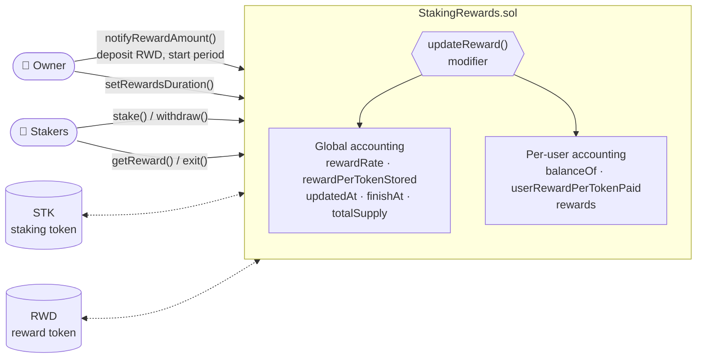
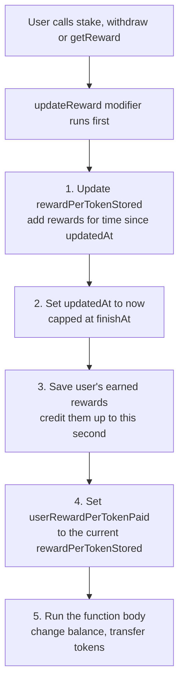
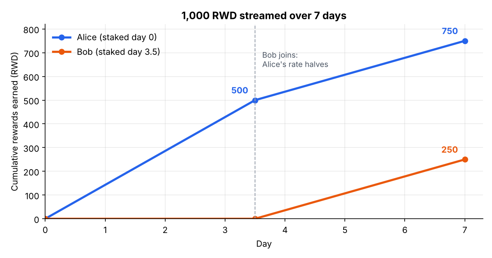
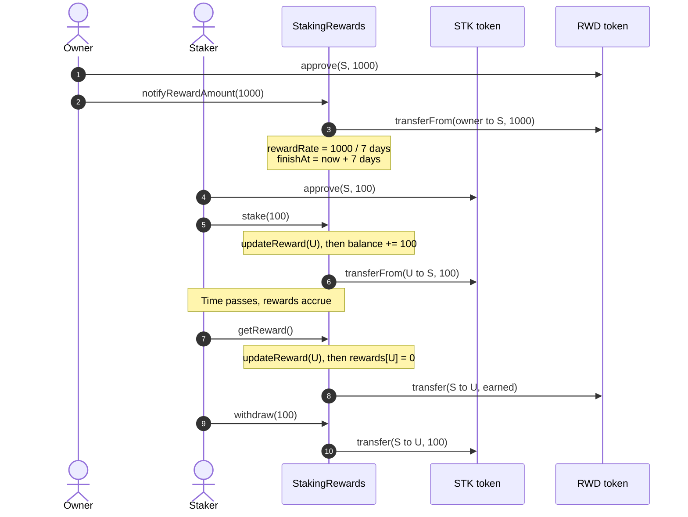
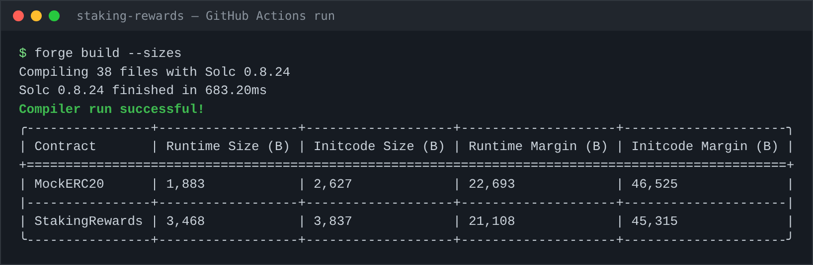
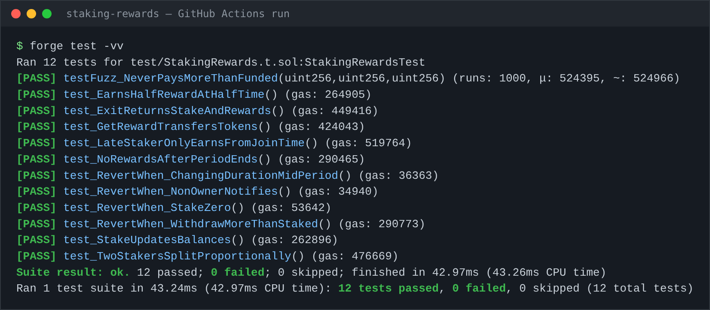
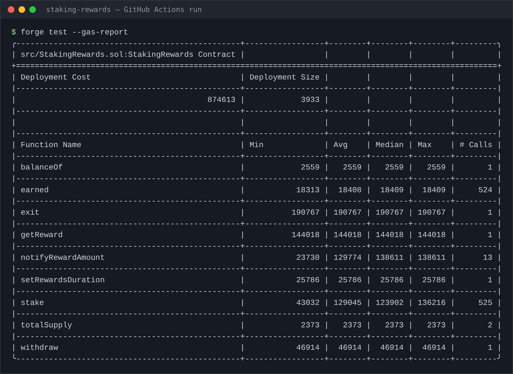
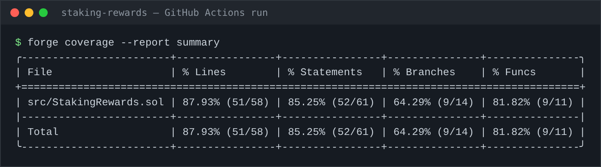

# Staking Rewards

[](https://github.com/rajdama/staking-rewards/actions/workflows/test.yml)


Stake an ERC-20 token and earn reward tokens over time, shared in proportion to your stake.
Built with [Foundry](https://getfoundry.sh/) and OpenZeppelin v5.

This is **project 1** of a hands-on Web3 learning path. It covers reward-accounting math,
the checks-effects-interactions pattern, reentrancy protection, and testing with Foundry
(unit tests, fuzz tests, gas reports and coverage).

---

## Table of contents

- [Architecture](#architecture)
- [How the reward math works](#how-the-reward-math-works)
- [Worked example](#worked-example)
- [User flows](#user-flows)
- [Contract API](#contract-api)
- [Results](#results)
- [Security notes](#security-notes)
- [Getting started](#getting-started)
- [Exercises](#exercises)

---

## Architecture



Every state-changing function runs the `updateReward` modifier **first**. It settles the global
reward counter up to the current second and credits the caller with what they earned so far,
before their balance changes. That ordering is what keeps everyone's rewards correct.

## How the reward math works

Rewards stream out at a fixed `rewardRate` (tokens per second) and are split among all
stakers by stake size. Paying everyone every second would require looping over all users,
which costs unbounded gas. Instead, the contract keeps **one global number**:

> **`rewardPerToken`** = total rewards earned by *one* staked token since the start

Whenever anything changes, it grows by:

```
rewardPerToken += rewardRate × secondsSinceLastUpdate × 1e18 / totalStaked
```

Each user stores the value of `rewardPerToken` from the last time their account was settled
(`userRewardPerTokenPaid`). Their earnings are just the difference:

```
earned = balance × (rewardPerToken − userRewardPerTokenPaid) / 1e18 + rewards (unclaimed)
```



Result: every operation is **O(1)**, whether there are 2 stakers or 2 million. The `1e18`
scaling keeps precision so small values don't round down to zero.

## Worked example

This is exactly what `test_LateStakerOnlyEarnsFromJoinTime` checks.
Setup: **1,000 RWD** over **7 days** → `rewardRate ≈ 1.6534 RWD/second`.

| Time | Event | Total staked | Δ rewardPerToken | rewardPerToken | Alice earned | Bob earned |
|---|---|---|---|---|---|---|
| Day 0 | Alice stakes 100 | 100 | — | 0 | 0 | — |
| Day 3.5 | Bob stakes 100 | 200 | 500 RWD ÷ 100 = **5.0** | 5.0 | 100 × 5.0 = **500** | 0 (paid = 5.0) |
| Day 7 | Period ends | 200 | 500 RWD ÷ 200 = **2.5** | 7.5 | 100 × 7.5 = **750** | 100 × (7.5 − 5.0) = **250** |

Alice got the whole pool while she was alone, then half of it once Bob joined. Bob only earns
from the moment he joined, because his `userRewardPerTokenPaid` was set to 5.0 when he staked.



## User flows



## Contract API

| Function | Who | What it does |
|---|---|---|
| `stake(amount)` | anyone | Deposit staking tokens and start earning |
| `withdraw(amount)` | staker | Take staking tokens back (rewards keep accruing on the rest) |
| `getReward()` | staker | Claim all earned reward tokens |
| `exit()` | staker | `withdraw` everything + `getReward` in one call |
| `earned(account)` | view | Rewards owed to an account right now |
| `rewardPerToken()` | view | Current accumulated reward per staked token (×1e18) |
| `notifyRewardAmount(amount)` | owner | Deposit rewards and start a period, rolling over any leftover |
| `setRewardsDuration(seconds)` | owner | Change period length (only after the current one ends) |

## Results

All results below are real output from the project's
[GitHub Actions run](https://github.com/rajdama/staking-rewards/actions/workflows/test.yml)
(Foundry 1.9.0, Solc 0.8.24, optimizer on, 200 runs).

### Build

The contract is 3,468 bytes, about 14% of Ethereum's 24 KB contract size limit.



### Tests: 12/12 passing

The fuzz test ran **1,000 random combinations** of stake amounts (1 wei up to 10¹² tokens)
and join times, and confirmed that total rewards owed never exceed what was funded.



### Gas report



| Action | Typical gas | Notes |
|---|---|---|
| `stake` | ~124k | First stake writes several new storage slots (most expensive case) |
| `withdraw` | ~47k | Cheap: slots already exist |
| `getReward` | ~144k | Includes the token transfer to the user |
| `exit` | ~191k | Cheaper than `withdraw` + `getReward` as two transactions |
| Deployment | ~875k | One-time cost |

### Coverage



87.9% of lines are covered. The gaps are mostly error branches the tests don't hit yet:
`RewardRateZero`, `RewardTooHigh`, the "extend an active period" branch of
`notifyRewardAmount`, and the same-token branch. Closing these gaps is a good first exercise.

## Security notes

- **Reentrancy:** all user functions are `nonReentrant`, and state is updated before token
  transfers (checks-effects-interactions).
- **Safe transfers:** uses OpenZeppelin `SafeERC20`, so tokens that don't return `bool` still work.
- **Solvency check:** `notifyRewardAmount` reverts if the contract can't pay the full period.
  When the staking and reward token are the same, staked funds are excluded from that check.
- **`block.timestamp` lint warning:** validators can shift timestamps by a few seconds. For a
  reward period measured in days, that changes payouts by a negligible amount, so it's accepted
  here (the same trade-off Synthetix makes).
- **Known limitation:** if nobody is staked for part of a period, those rewards are never
  distributed and stay locked in the contract (see exercise 2).
- **Not audited.** This is a learning project. Don't use it with real funds.

## Getting started

```bash
# 1. Install Foundry (once)
curl -L https://foundry.paradigm.xyz | bash
foundryup

# 2. Clone and install dependencies
git clone https://github.com/rajdama/staking-rewards
cd staking-rewards
forge install foundry-rs/forge-std OpenZeppelin/openzeppelin-contracts@v5.1.0

# 3. Build and test
forge build
forge test -vv
```

More commands:

```bash
forge test --match-test testFuzz -vvv   # only the fuzz test
forge test --gas-report                 # gas per function
forge coverage --report summary         # line/branch coverage
```

### Deploy to Sepolia

```bash
cast wallet import dev --interactive    # store a testnet key, encrypted (once)
forge script script/Deploy.s.sol --rpc-url $SEPOLIA_RPC_URL --account dev --broadcast
```

Get Sepolia ETH from a faucet first, and never use a key that holds real funds.

### Project structure

```
src/StakingRewards.sol          the contract
test/StakingRewards.t.sol       12 unit + fuzz tests
test/mocks/MockERC20.sol        mintable token for tests
script/Deploy.s.sol             testnet deployment
.github/workflows/test.yml      CI: build, test, gas report, coverage
docs/images/                    screenshots of CI results
```

## Exercises

1. **Trace the math.** Before changing anything, work through
   `test_LateStakerOnlyEarnsFromJoinTime` by hand using the [worked example](#worked-example).
2. **Find the stuck-rewards bug.** Write a test proving that rewards for time when nobody is
   staked get locked forever. Then add an owner function to recover them, without touching
   staked funds or rewards already owed.
3. **Get branch coverage to 100%.** Add tests for every uncovered error path listed in
   [Coverage](#coverage).
4. **Write an invariant test.** Build a handler contract that randomly stakes, withdraws and
   claims for several users. Invariant: the contract's reward balance is always ≥ total owed.
5. **Add a lock period.** Users can't withdraw for 3 days after staking. What should happen
   when someone stakes again during their lock?
6. **Try an attack.** Write a fee-on-transfer token mock and see which accounting breaks.
7. **Ship it.** Deploy to Sepolia, verify on Etherscan, and add the addresses here.

---

*Design based on the Synthetix `StakingRewards` pattern.*
